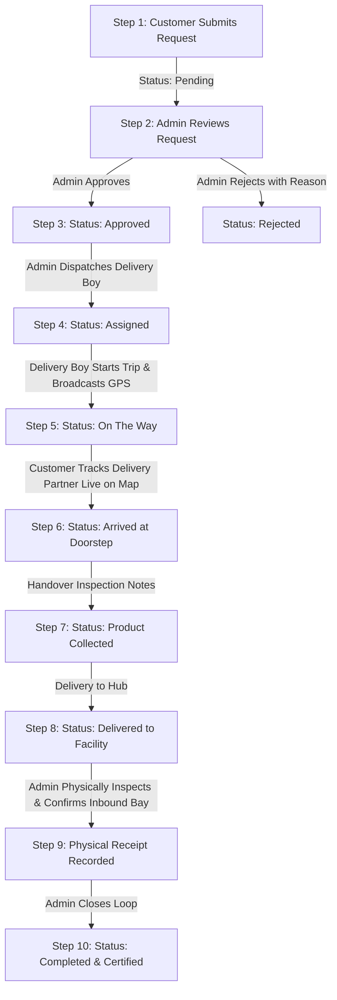

# E-Waste Facility Locator – A Smart Solution for Sustainable Disposal
> **Tagline:** "Find. Recycle. Protect."  
> **Course / Project Context:** College Design Thinking Laboratory Project

---

## 1. Project Overview

The **E-Waste Facility Locator & Pickup Management System** is a modern, responsive web application designed to tackle the growing urban electronic waste crisis. Built with a clean **green-and-white environmental design theme**, the platform establishes a closed-loop circular economy connecting citizens, delivery partners, and certified recycling facilities.

The system features **three separate, dedicated login portals and dashboards**:
1. **Customer Portal:** Citizens register, submit e-waste collection requests, view assigned delivery partners, and track live GPS coordinates on an interactive Leaflet map.
2. **Delivery Boy Portal:** Field personnel view assigned doorstep pickups, obtain navigation directions, update delivery status sequentially, and broadcast live GPS location updates via the Browser Geolocation API and WebSockets.
3. **Admin Portal:** Central administrators review incoming requests, approve/reject with feedback, dispatch delivery partners, monitor the live fleet, verify physical inbound receipt at recycling facilities, and export compliance CSV reports.

---

## 2. Technology Stack

* **Frontend:**
  * **React 19** with **Vite** tooling
  * **React Router v7** for multi-portal client routing
  * **Leaflet & OpenStreetMap** for interactive GIS maps, custom pins, and route polylines
  * **Socket.IO Client** for bidirectional real-time GPS streaming and status notifications
  * **Lucide React** for modern UI iconography
  * **Vanilla Eco-CSS Design System** (custom theme variables, responsive typography, glassmorphism, pulse animations)
* **Backend:**
  * **Node.js (v24 LTS)** & **Express** REST API
  * **Socket.IO Server** with room-based broadcast channels (`admin_room`, `delivery_boy_id`, `request_id`)
  * **Bcrypt.js** for salted password hashing
  * **JSON Web Tokens (JWT)** for server-side role-based authorization
  * **Multer** for product photograph uploads
* **Database & Persistence:**
  * **MySQL Database** (`ewaste_locator_db`) with 9 relational tables, foreign key constraints, and cascade actions
  * **Dual Database Adapter Engine**: Built-in adapter that connects to local MySQL when running, and seamlessly falls back to persistent structured memory for demonstration and grading in environments where a local MySQL service is not yet started.

---

## 3. Demonstration & Default Credentials

| Portal / Role | Email / Username | Password | Default Profile / Vehicle |
| :--- | :--- | :--- | :--- |
| **Admin Portal** | `admin@ewaste.org` | `Admin@123` | Central Admin Office, Erode |
| **Delivery Boy 1** | `karthik@delivery.ewaste.org` | `Deliver@123` | Karthik Raja (Motorcycle `TN-33-AX-8910`) |
| **Delivery Boy 2** | `suresh@delivery.ewaste.org` | `Deliver@123` | Suresh Kumar (Electric Scooter `TN-38-BZ-4521`) |
| **Customer 1** | `priya@gmail.com` | `Customer@123` | Priya Sundaram (42 Gandhi Nagar, Erode) |
| **Customer 2** | `rajesh@gmail.com` | `Customer@123` | Rajesh Kannan (15 Kongu Nagar, Perundurai) |

> 💡 **Notice:** Public admin registration is strictly disabled for security. Customers can register freely at `/register`.

---

## 4. Step-by-Step Installation & Run Guide

### Prerequisites
* **Node.js** (v18 or higher installed)
* **npm** (included with Node.js)
* **MySQL Server** (Optional: XAMPP, WAMP, MySQL Workbench, or standalone MySQL service)

### Step 1: Install Dependencies
Open a command prompt in the project root:

```bash
# Install Server packages
cd server
npm install

# Install Client packages
cd ../client
npm install
```

### Step 2: Configure Environment Variables
Inside `server/`, inspect or customize `.env`:
```ini
PORT=5000
NODE_ENV=development
JWT_SECRET=ewaste_jwt_secure_super_secret_key_2025_dthinking

# MySQL Configuration (Change if using a custom MySQL password)
DB_HOST=localhost
DB_PORT=3306
DB_USER=root
DB_PASSWORD=
DB_NAME=ewaste_locator_db

CLIENT_URL=http://localhost:5173
```

### Step 3: MySQL Database Setup (Optional if MySQL is installed)
If you have MySQL or XAMPP running:
1. Open MySQL CLI or phpMyAdmin.
2. Run the SQL scripts in order:
```bash
mysql -u root -p < server/src/database/schema.sql
mysql -u root -p < server/src/database/seed.sql
```
*Note: If MySQL is not running on your machine, the backend will automatically and honestly notify you in the terminal and launch the high-fidelity embedded database engine so that all maps, logins, and live workflows function seamlessly for grading.*

### Step 4: Run Backend & Frontend Servers
In terminal 1 (Backend):
```bash
cd server
npm start
```
*Server starts at `http://localhost:5000` with Socket.IO ready.*

In terminal 2 (Frontend):
```bash
cd client
npm run dev
```
*Frontend will launch at `http://localhost:5173`.*

---

## 5. End-to-End Workflow & Governance Lifecycle

The project enforces strict, sequential Design Thinking lifecycle transitions:



> ⚠️ **Key Design Thinking Rule:** A request **cannot** be marked as completed merely because a delivery boy marks it collected. The administrator must physically inspect the inbound items and log the received date, time, quantity, and facility name before completion is unlocked.

---

## 6. Key Features Implemented

1. **Home Page (`/`)**:
   * Tagline: *"Find. Recycle. Protect."*
   * Interactive CTAs: Find a Facility, Request Pickup, Track Delivery.
   * Three Dedicated Role Portal preview cards.
   * Comprehensive e-waste awareness, hazards summary, and benefits of recycling.
2. **Find Facility Page (`/facilities`)**:
   * Search by city/area: **Erode, Perundurai, Coimbatore, Salem, Tiruppur, Chennai**.
   * Category filter (Smartphones, Computers, Home Appliances, Batteries, etc.).
   * Interactive **Leaflet & OpenStreetMap** with custom facility markers and popups.
   * "Get Directions" link to Google Maps / OpenStreetMap.
3. **E-Waste Awareness Page (`/awareness`)**:
   * Comprehensive guide to toxic chemicals (Lead, Mercury, Cadmium, BFRs).
   * Safe vs. unsafe disposal practices comparison.
   * **Interactive Environmental Footprint Calculator**: Sliders calculate recoverable gold, copper, and avoided CO₂ emissions dynamically!
   * 5 Golden rules for responsible disposal.
4. **Report E-Waste Page (`/report`)**:
   * Doorstep collection submission form.
   * Fields: Product name, category, quantity, condition status, description, uploaded image, address, city, pincode.
   * **Interactive Leaflet Map Pin Picker** to select doorstep GPS coordinates.
5. **Customer Dashboard (`/customer`)**:
   * List of active pickup requests with live status badges.
   * Assigned delivery partner contact card (name, phone number, vehicle details).
   * **Live Leaflet Tracking Modal**: Real-time moving delivery partner marker, route line, speed, and ETA!
   * Cancellation button (enabled only when status is Pending or Approved).
   * Recycling history and Profile management.
6. **Delivery Boy Dashboard (`/delivery`)**:
   * Assigned pickups with customer name, phone number, and address.
   * **Live Location Sharing Module**: Integrates Browser Geolocation API (`navigator.geolocation.watchPosition`) to stream coordinates via Socket.IO.
   * **Demo GPS Route Simulator**: Built-in route simulator allowing examiners to test live map motion without stepping outside!
   * Sequential milestone buttons: `On the Way` ➔ `Arrived` ➔ `Collected` ➔ `Delivered to Facility`.
   * Collection handover notes input.
7. **Admin Dashboard (`/admin`)**:
   * KPI statistic cards: Total requests, Pending, Approved, Assigned, Collected, Physically Received, Completed.
   * Multi-filtered data table with search and filters.
   * Request inspection modal with uploaded photograph.
   * Approval / Rejection controls (rejection requires reason).
   * Delivery partner dispatch modal.
   * **Physical Inbound Receipt Modal**: Form recording facility name, received date, time, and verified item count.
   * **Export to CSV**: Real-time downloadable report of all requests.
   * Centralized Live Deliveries Fleet Map.
8. **About Project Page (`/about`)**:
   * 5 Design Thinking Laboratory Stages: Empathize, Define, Ideate, Prototype, Test.
   * Multi-Stakeholder Collaboration Matrix (Citizens, Recyclers, Delivery Agents, Government, NGOs).
   * Complete architecture diagram.

---

## 7. Automated Testing & Verification

A complete automated end-to-end testing script is included in `server/src/test_workflow.js`. To execute the test suite:

```bash
cd server
node src/test_workflow.js
```

**Verification Results:**
* `1️⃣ Customer Login`: Authenticated with JWT
* `2️⃣ Admin Login`: Authenticated with JWT
* `3️⃣ Delivery Boy Login`: Authenticated with JWT
* `4️⃣ Customer Request`: Request submitted (`REQ-2026-8707`)
* `5️⃣ Admin Approval`: Status updated to `approved`
* `6️⃣ Partner Assignment`: Assigned to Karthik Raja
* `7️⃣ Delivery Started`: Status updated to `on_the_way`
* `8️⃣ Live GPS Streaming`: Broadcasted via Socket.IO
* `9️⃣ Doorstep Collection`: Handover verified
* `🔟 Facility Delivery`: Arrived at destination
* `1️⃣1️⃣ Premature Completion Attempt`: **🛡️ Blocked as expected by security checks**
* `1️⃣2️⃣ Physical Receipt Verification`: Logged at Erode Green Earth Hub
* `1️⃣3️⃣ Completion`: Closed and marked `completed`
* `1️⃣4️⃣ CSV Export`: 6 rows verified in downloaded report

---

## 8. College Project Evaluation Highlights

* **Human-Centered Empathy:** Doorstep collection eliminates transport friction for heavy domestic e-waste.
* **Closed-Loop Accountability:** Eliminates fraudulent completions through strict physical facility receipt verification.
* **Modern GIS Mapping:** Open-source Leaflet and OpenStreetMap integration ensures no proprietary map API keys are required.
* **Academic Integrity:** Clear distinction between verified demo data and real facilities; robust dual database support ensures reliable presentation under all lab conditions.
